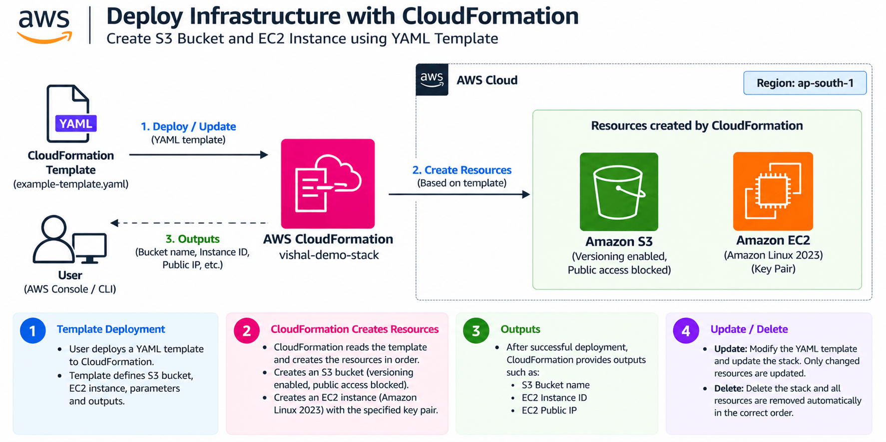
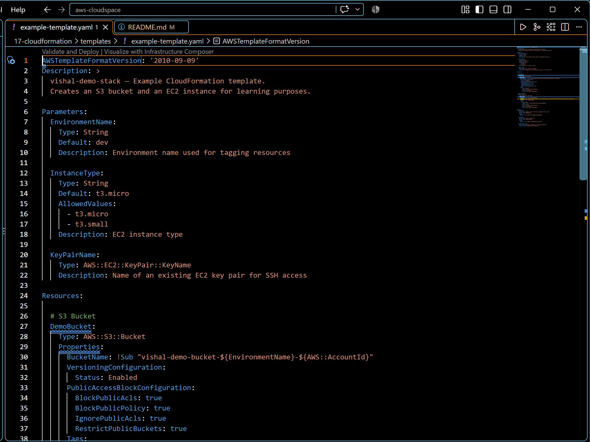
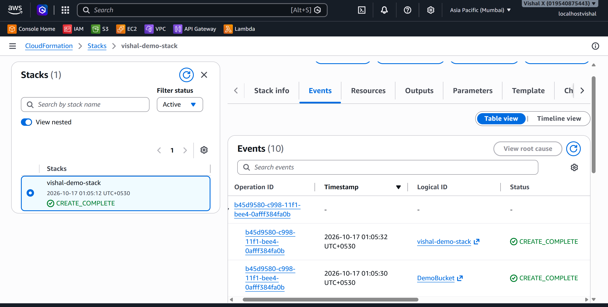
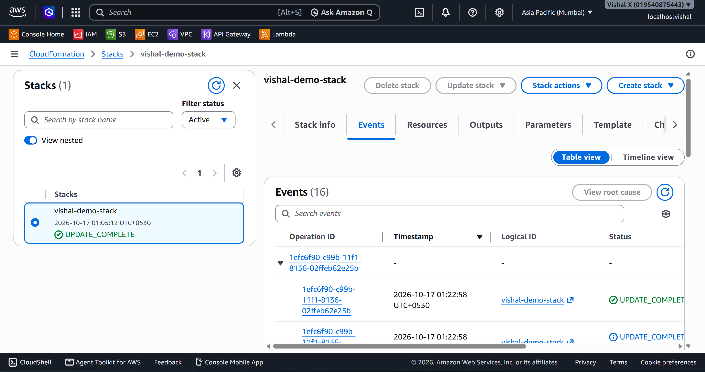
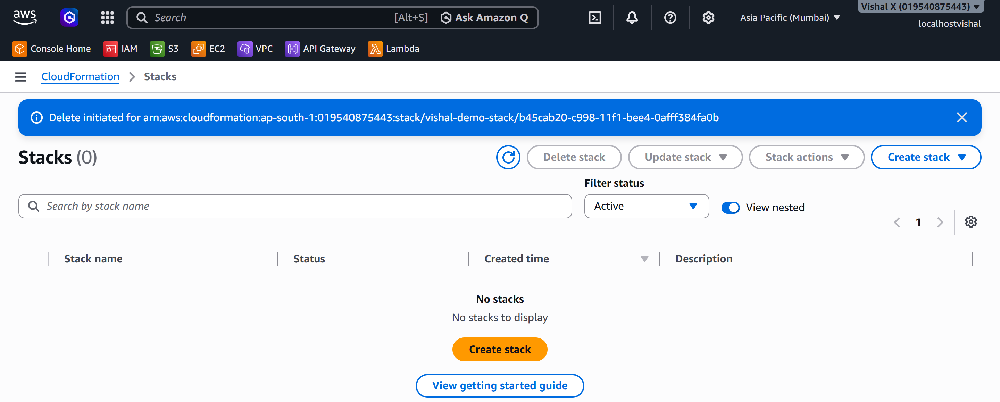

# Deploy Infrastructure with CloudFormation

Seventeenth project. Infrastructure as Code — wrote a YAML template, deployed it as a CloudFormation stack, updated it, then deleted the whole stack in one action. No console clicking.

## What I built

A CloudFormation stack that creates an S3 bucket and an EC2 instance from a YAML template. Deployed it, updated it with a change, then deleted the whole thing in one action — all resources gone cleanly.

## Why CloudFormation

Every project before this involved clicking through the console. That works for learning but doesn't scale — it's slow, error-prone, and hard to repeat exactly. CloudFormation flips that. The infrastructure is in a file, stored in version control, deployed the same way every time. This is how real AWS environments are managed.

## Services used

| Service | What I used it for |
|---------|-------------------|
| CloudFormation | Reads the YAML template and creates/manages the AWS resources |
| S3 | Created as a resource by the template |
| EC2 | Created as a resource by the template |

## Resources I created

| Resource | Value |
|----------|-------|
| Region | ap-south-1 |
| Stack name | vishal-demo-stack |
| Template | templates/example-template.yaml |

---

## Steps

### 1. Reviewed the CloudFormation template

The template is already in `templates/example-template.yaml` in this project folder. Open it in any text editor (VS Code, Notepad, etc.) and review the structure before deploying.

The template defines:
- An **S3 bucket** with versioning enabled and public access blocked
- An **EC2 instance** using the latest Amazon Linux 2023 AMI
- **Parameters** for environment name, instance type, and key pair name
- **Outputs** that display the bucket name, instance ID, and public IP after deployment

One thing to check before deploying: the template requires a `KeyPairName` parameter — make sure you have an existing key pair in `ap-south-1`. You can check under EC2 → Key Pairs.

---

### 2. Created the stack

1. Open the **CloudFormation** console
2. Click **Stacks** → **Create stack** → **With new resources (standard)**
3. On the Specify template page:
   - Prepare template: **Upload a template file**
   - Click **Choose file** → select `templates/example-template.yaml`
4. Click **Next**
5. Stack name: `vishal-demo-stack`
6. Configure any parameters defined in the template → click **Next**
7. Stack options: leave defaults → click **Next**
8. If the template creates IAM resources, tick **I acknowledge that AWS CloudFormation might create IAM resources**
9. Click **Submit**

Watch the **Events** tab — CloudFormation creates each resource in order. When done, the stack status changes to `CREATE_COMPLETE`.

---

### 3. Updated the stack

1. Modify the template locally (e.g. add a tag to the S3 bucket)
2. CloudFormation → **Stacks** → click `vishal-demo-stack` → **Update**
3. Select **Replace current template** → upload the modified template → **Next**
4. Parameters page: leave as is → **Next**
5. Stack options: leave defaults → **Next**
6. On the **Review** page, scroll down to the **Change set preview** section — this shows exactly what will be added, modified, or removed before anything happens
7. Click **Submit**

CloudFormation creates a change set and executes it automatically. Watch the Events tab — only the changed resources are updated, not a full rebuild.

---

### 4. Deleted the stack

1. CloudFormation → **Stacks** → tick `vishal-demo-stack` → **Delete** → **Delete stack**

CloudFormation deletes all resources in the correct order. When finished, the stack disappears from the list.

---

## Screenshots

| # | File | Description |
|---|------|-------------|
| 01 | `screenshots/01-template.png` | CloudFormation template open in editor |
| 02 | `screenshots/02-stack-created.png` | Stack showing CREATE_COMPLETE with resources listed |
| 03 | `screenshots/03-stack-updated.png` | Stack showing UPDATE_COMPLETE after template change |
| 04 | `screenshots/04-stack-deleted.png` | CloudFormation stacks list with the stack removed |

## Commands

See [commands/commands.md](./commands/commands.md)

---

## Things that can go wrong

| Problem | What caused it | How I fixed it |
|---------|----------------|----------------|
| ROLLBACK_COMPLETE | Resource creation failed | Checked Events tab for the specific error message |
| IAM acknowledgment required | Template creates IAM resources | Ticked the IAM acknowledgment checkbox |
| Stack stuck in DELETE_FAILED | A resource has a dependency | Manually deleted the blocking resource, then retried |
| Template validation error | YAML syntax error | Used `aws cloudformation validate-template` to check |

---

## Security considerations

- CloudFormation execution role should only have permissions to create the resources in the template
- Enable termination protection on production stacks
- Don't put secrets or credentials in templates — use AWS Secrets Manager or Parameter Store

---

## Cost

CloudFormation itself is free. The resources it creates (EC2, S3) incur normal costs. Delete the stack after the exercise to remove all resources and stop charges.

---

## What I learned

- Infrastructure as Code means the infrastructure is defined in a file, not in console clicks
- A stack manages all resources as a unit — create, update, and delete together
- Change sets let me preview what will change before applying an update
- CloudFormation handles resource dependencies automatically — it knows the right creation order
- Deleting a stack removes all its resources cleanly in one action
