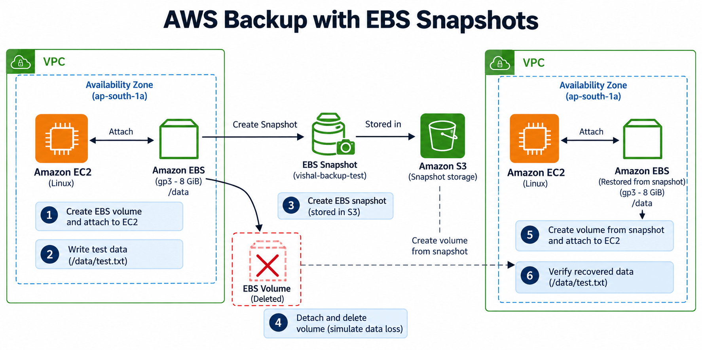
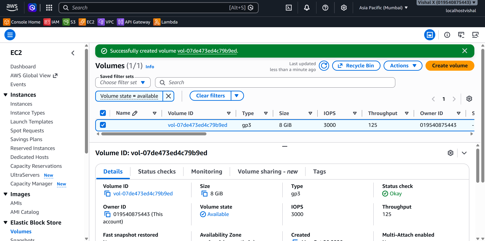
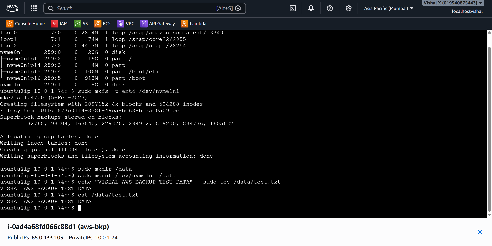
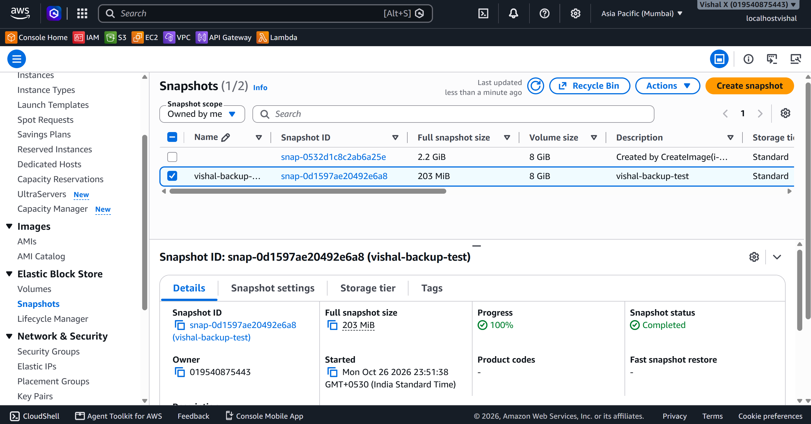
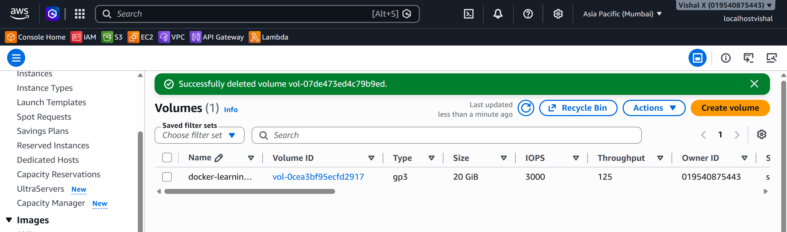
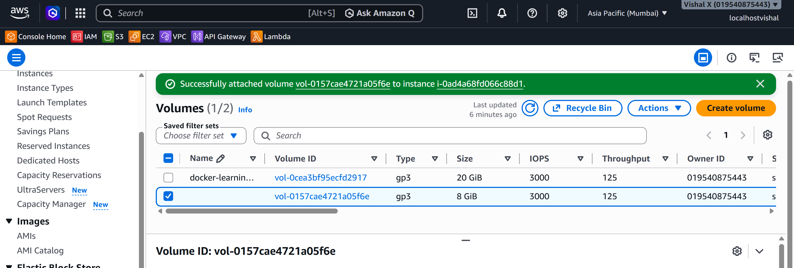
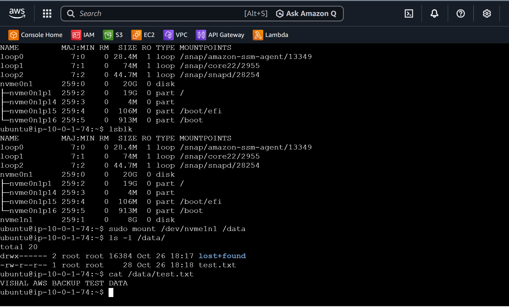

# AWS Backup with EBS Snapshots

Eighteenth project. Backup and recovery using EBS snapshots — created a volume, attached it to EC2, wrote test data, took a snapshot, then deleted the volume on purpose to simulate data loss. Restored from the snapshot and verified the data came back.

## What I built

A full backup and recovery cycle using EBS snapshots. Wrote test data to a volume, snapshotted it, deleted the volume to simulate a failure, restored from the snapshot, and confirmed the data was still there.



## Why EBS snapshots

Knowing how to take a snapshot is easy. Knowing the data actually comes back is what matters. This project was about going through the full cycle — write data, back it up, lose it, get it back. EBS snapshots are incremental, stored in S3, and survive even if the original volume is deleted.

## Services used

| Service | What I used it for |
|---------|-------------------|
| EC2 | The instance the EBS volume is attached to |
| EBS | The block storage volume that holds the test data |
| EBS Snapshots | Point-in-time backup of the EBS volume stored in S3 |

## Resources I created

| Resource | Value |
|----------|-------|
| Region | ap-south-1 |
| Volume type | gp3 |
| Volume size | 8 GiB |
| Filesystem | ext4 |
| Mount point | /data |
| Test file | /data/test.txt |

---

## Steps

### 1. Created an EBS volume

Created a gp3 volume (8 GiB) in the same AZ as the EC2 instance — has to be the same AZ or you can't attach it.



---

### 2. Attached the volume and wrote test data

Attached the volume to the instance, then SSHed in to format it, mount it, and write test data.

> Run `lsblk` first — on newer instance types the device shows up as `/dev/nvme1n1`, not `/dev/xvdf`.

```bash
lsblk
sudo mkfs -t ext4 /dev/xvdbf
sudo mkdir /data
sudo mount /dev/xvdbf /data
echo "VISHAL AWS BACKUP TEST DATA" | sudo tee /data/test.txt
cat /data/test.txt
```



---

### 3. Created a snapshot

Created a snapshot of the volume from the EC2 console, tagged it `vishal-backup-test`, and waited for status to show Completed.



---

### 4. Simulated data loss

Unmounted the volume, detached it, then deleted it.

```bash
sudo umount /data
```



---

### 5. Restored from snapshot

Created a new volume from the snapshot — same volume type, same AZ — then attached it to the instance.



---

### 6. Verified recovered data

SSHed back in and mounted the restored volume. No formatting — the filesystem is already there from the snapshot.

```bash
lsblk
sudo mount /dev/nvme1n1 /data
cat /data/test.txt
```

Output:

```
VISHAL AWS BACKUP TEST DATA
```



---

### 7. Cleaned up

Unmounted the volume, detached and deleted it, then deleted the snapshot.

---

## Screenshots

| # | File | Description |
|---|------|-------------|
| 01 | `screenshots/01-ebs-volume.png` | New gp3 volume with status Available |
| 02 | `screenshots/02-test-data.png` | Terminal showing volume mounted and test data written |
| 03 | `screenshots/03-snapshot-created.png` | Snapshot with status Completed |
| 04 | `screenshots/04-volume-deleted.png` | Volumes list with the test volume removed |
| 05 | `screenshots/05-volume-restored.png` | New volume created from snapshot with status Available |
| 06 | `screenshots/06-data-verified.png` | Terminal showing test.txt with original content after restore |

## Commands

See [commands/commands.md](./commands/commands.md)

---

## Things that can go wrong

| Problem | What caused it | How I fixed it |
|---------|----------------|----------------|
| Can't attach volume | Different AZ from instance | Created the volume in the same AZ as the instance |
| Device not visible after attach | Instance type uses NVMe naming | Ran `lsblk` to find the actual device name |
| Mount fails after restore | Tried to mkfs a restored volume | Didn't format — just mounted. The filesystem is already there |
| Data not found after mount | Wrong mount point | Checked `lsblk` and `df -h` to confirm the right device was mounted |

---

## What I learned

- EBS snapshots are point-in-time backups stored in S3 — they survive even if the volume is deleted
- The volume and the EC2 instance must be in the same Availability Zone
- Device names can differ between instance types — always run `lsblk` to verify
- Restoring from a snapshot creates a new volume — don't format it, just mount it
- Snapshots are incremental — only changed blocks are stored after the first one
