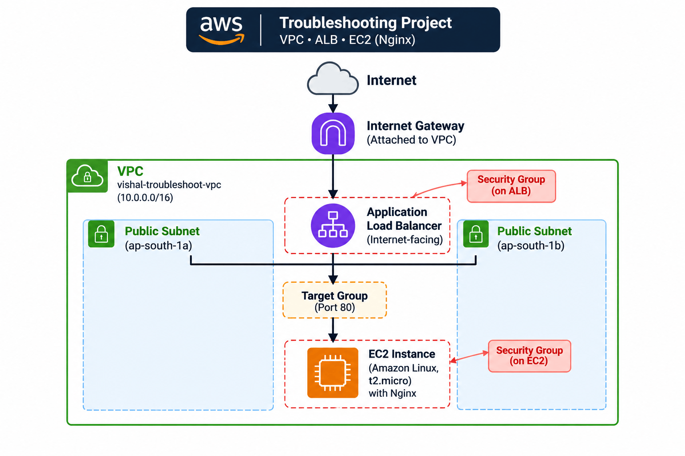
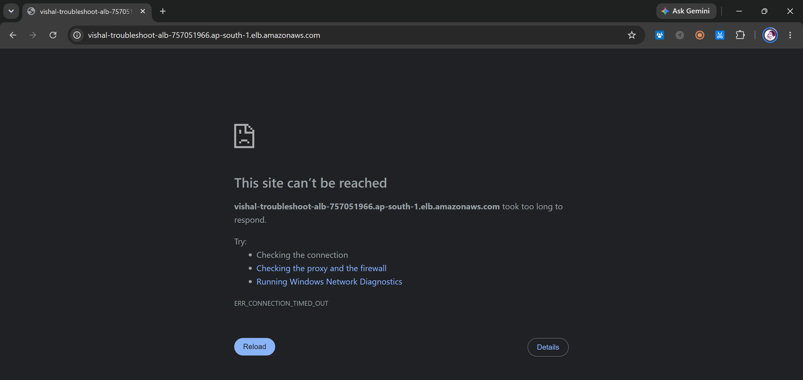
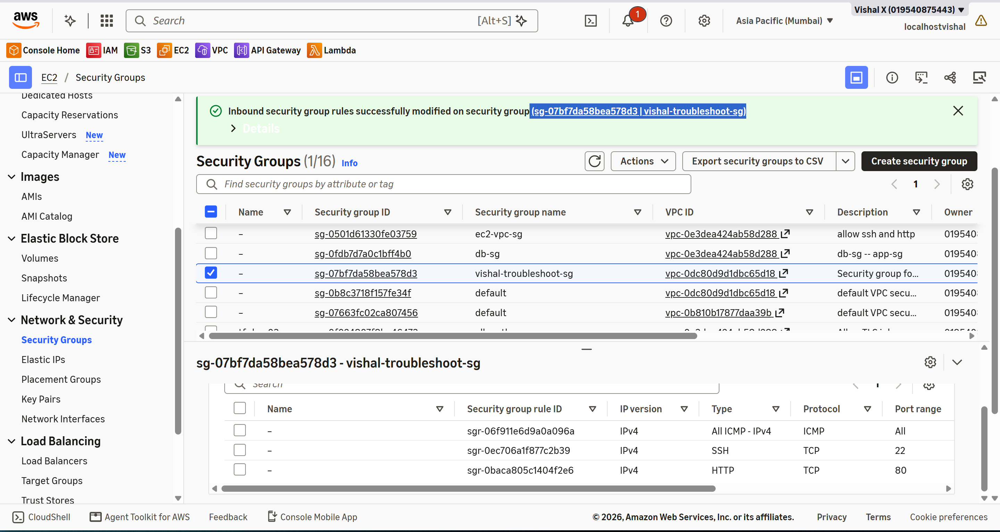
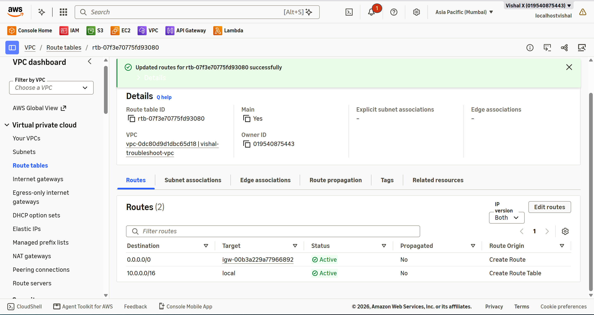
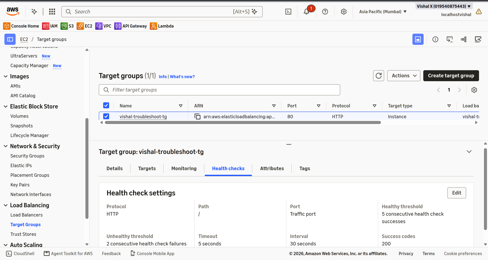
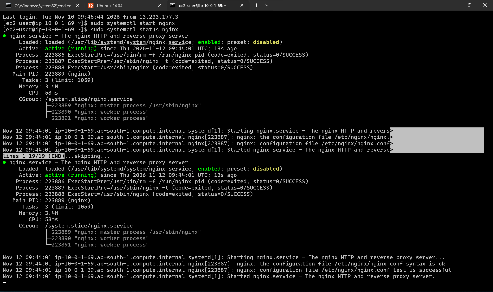
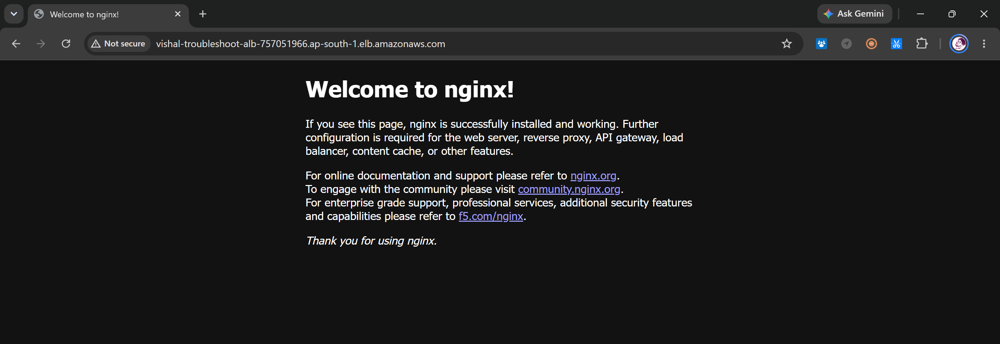

# Troubleshoot a Broken AWS Application

Nineteenth project. Systematic troubleshooting — intentionally broke an AWS application by misconfiguring security groups, removing a route table entry, and breaking a health check, then diagnosed and fixed each issue layer by layer.

## What I built

A broken AWS application that I fixed. The point wasn't to build something new — it was to get comfortable diagnosing connectivity issues, security group problems, routing failures, and ALB health check errors. The kind of stuff that comes up constantly.



## Why troubleshooting

Every project before this was about building things. This one is about fixing them. Knowing how to build an EC2 web server is useful. Knowing why it's not responding when it should be is more useful. Security groups and route tables are the most common causes of connectivity issues — this project was about getting comfortable diagnosing them without guessing.

## Services used

| Service | What I used it for |
|---------|-------------------|
| EC2 | The application server being troubleshot |
| Security Groups | Firewall rules — a common source of connectivity issues |
| VPC / Route Tables | Network routing — missing IGW route breaks internet access |
| ALB | Load balancer — health check failures prevent traffic |
| CloudWatch | Logs and metrics for diagnosing issues |

## Resources used

| Resource | Value |
|----------|-------|
| Region | ap-south-1 |
| Starting point | Fresh EC2 instance + ALB — launched and intentionally broken for this project |

---

## Steps

### 1. Set up the broken environment

Launched a fresh EC2 instance with an ALB, then broke it in four specific ways.

**Launch the VPC and EC2:**

1. VPC → **Your VPCs** → **Create VPC**
   - Name: `vishal-troubleshoot-vpc`
   - IPv4 CIDR: `10.0.0.0/16`
2. VPC → **Subnets** → **Create subnet** — create two public subnets in different AZs (required for ALB)
   - `vishal-public-subnet-1` — `10.0.1.0/24` — `ap-south-1a`
   - `vishal-public-subnet-2` — `10.0.2.0/24` — `ap-south-1b`
3. VPC → **Internet Gateways** → **Create internet gateway** → name `vishal-troubleshoot-igw` → **Attach to VPC**
4. VPC → **Route Tables** → find the route table for your VPC → **Routes** tab → **Edit routes** → add `0.0.0.0/0` → Internet Gateway → **Save changes**
5. For each subnet: **Subnet settings** → **Edit subnet settings** → enable **Auto-assign public IPv4 address**
6. EC2 → **Security Groups** → **Create security group**
   - Name: `vishal-troubleshoot-sg`
   - VPC: `vishal-troubleshoot-vpc`
   - Inbound rules: SSH port 22 from My IP only
   - Do NOT add HTTP port 80 yet — this is the first break
7. EC2 → **Instances** → **Launch instance**
   - Name: `vishal-troubleshoot-ec2`
   - AMI: Amazon Linux 2023
   - Instance type: t2.micro
   - Key pair: your existing key pair
   - Network: `vishal-troubleshoot-vpc` → `vishal-public-subnet-1`
   - Security group: `vishal-troubleshoot-sg`
   - User data:
     ```bash
     #!/bin/bash
     yum install -y nginx
     systemctl start nginx
     systemctl enable nginx
     ```

**Launch the ALB:**

8. EC2 → **Load Balancing** → **Target Groups** → **Create target group**
   - Target type: Instances
   - Name: `vishal-troubleshoot-tg`
   - Protocol: HTTP, Port: 80
   - VPC: `vishal-troubleshoot-vpc`
   - Health check path: `/healthz` — this path doesn't exist, so health checks will fail (second break)
   - Register `vishal-troubleshoot-ec2` as a target
9. EC2 → **Load Balancing** → **Load Balancers** → **Create load balancer** → **Application Load Balancer**
   - Name: `vishal-troubleshoot-alb`
   - Scheme: Internet-facing
   - VPC: `vishal-troubleshoot-vpc` — select both public subnets
   - Security group: `vishal-troubleshoot-sg`
   - Listener: HTTP port 80 → forward to `vishal-troubleshoot-tg`

**Introduce the remaining breaks:**

10. VPC → **Route Tables** → find the route table → **Routes** tab → **Edit routes** → delete the `0.0.0.0/0` → IGW route → **Save changes** (third break)
11. SSH into the EC2 instance and stop nginx:
    ```bash
    sudo systemctl stop nginx
    ```
    (fourth break)

At this point the application is broken in four ways — no HTTP in the security group, no IGW route, wrong health check path, and the web server is stopped.


---

### 2. Identified the symptom

The browser showed:

```
ERR_CONNECTION_TIMED_OUT
```

Instead of changing things randomly, I worked through each layer:
1. Is the EC2 instance running?
2. Is the Security Group correct?
3. Is the route table correct?
4. Is the ALB health check passing?
5. Is the web server actually running?



---

### 3. Checked and fixed the Security Group

1. EC2 → **Instances** → click the instance → **Security** tab → click the security group link
2. Click the **Inbound rules** tab — check for HTTP port 80
3. If missing: click **Edit inbound rules** → **Add rule**
   - Type: **HTTP**
   - Source: `0.0.0.0/0`
4. Click **Save rules**



---

### 4. Checked and fixed the Route Table

1. Go to **VPC** console → **Route Tables**
2. Find the route table for the VPC → click it
3. Click the **Routes** tab — check for a `0.0.0.0/0` route pointing to an Internet Gateway
4. If missing: click **Edit routes** → **Add route**
   - Destination: `0.0.0.0/0`
   - Target: select the **Internet Gateway**
5. Click **Save changes**



---

### 5. Checked ALB health check

1. EC2 → **Load Balancing** → **Target Groups** → click the target group
2. Click the **Targets** tab — check the health status of each target
3. If unhealthy: click the **Health checks** tab → **Edit**
   - Health check path: `/` (must return HTTP 200)
   - Click **Save changes**



---

### 6. Investigated application logs

SSH'd into the EC2 instance and checked the web server:

```bash
# Check if web server is running
sudo systemctl status nginx

# If stopped, start it
sudo systemctl start nginx
sudo systemctl enable nginx

# Check logs
sudo tail -f /var/log/nginx/error.log
```



---

### 7. Verified the application was working

After applying all fixes, opened the ALB DNS name in a browser — the application loaded successfully.




---

### 8. Cleaned up

Deleted all resources in this order:

1. EC2 → **Load Balancers** → select `vishal-troubleshoot-alb` → **Actions** → **Delete**
2. EC2 → **Target Groups** → select `vishal-troubleshoot-tg` → **Actions** → **Delete**
3. EC2 → **Instances** → select `vishal-troubleshoot-ec2` → **Instance state** → **Terminate**
4. VPC → **Internet Gateways** → select `vishal-troubleshoot-igw` → **Actions** → **Detach from VPC** → then **Delete**
5. VPC → **Subnets** → delete both subnets
6. VPC → **Your VPCs** → select `vishal-troubleshoot-vpc` → **Actions** → **Delete VPC**

---

## Troubleshooting checklist

Before declaring the application fixed, verify:

- [ ] EC2 instance is in `Running` state
- [ ] Security Group allows HTTP port 80 inbound
- [ ] Route table has `0.0.0.0/0` → Internet Gateway for the public subnet
- [ ] ALB health check is passing (targets show Healthy)
- [ ] Web server is running (`systemctl status`)
- [ ] Application logs show no critical errors

---

## Screenshots

| # | File | Description |
|---|------|-------------|
| 01 | `screenshots/01-setup-complete.png` | EC2 instance Running and ALB Active before troubleshooting |
| 02 | `screenshots/02-connection-error.png` | Browser showing ERR_CONNECTION_TIMED_OUT |
| 03 | `screenshots/03-security-group-fixed.png` | Security group with HTTP port 80 added |
| 04 | `screenshots/04-route-table-fixed.png` | Route table with 0.0.0.0/0 → Internet Gateway |
| 05 | `screenshots/05-target-health.png` | Target group showing target health status |
| 06 | `screenshots/06-application-logs.png` | Terminal showing web server status or logs |
| 07 | `screenshots/07-application-working.png` | Browser showing the application working after fixes |

## Commands

See [commands/commands.md](./commands/commands.md)

---

## Things that can go wrong

| Problem | What caused it | How I fixed it |
|---------|----------------|----------------|
| Still timing out after SG fix | Route table missing IGW route | Added 0.0.0.0/0 → IGW to the route table |
| 502 after fixing network | Web server not running | Started the web server with systemctl |
| Target still unhealthy | Health check path returning non-200 | Updated health check path to one that returns 200 |
| Can't SSH | SSH port 22 not in SG | Added SSH inbound rule restricted to my IP |

---

## Security considerations

- Never open SSH (port 22) to `0.0.0.0/0` in production — restrict to known IPs
- Security Groups should follow least privilege — only open the ports actually needed
- ALB security group should only allow HTTP/HTTPS from the internet; EC2 security group should only allow traffic from the ALB

---

## Cost

New resources launched for this project: 1 EC2 t2.micro, 1 ALB, 1 VPC. All deleted after completion. Estimated cost under $1 for a few hours of work.

---

## What I learned

- Systematic troubleshooting is faster than random changes — work through each layer
- Security Groups and Route Tables are the most common causes of connectivity issues
- ALB health checks must return HTTP 200 — any other response marks the target unhealthy
- Application logs are the fastest way to diagnose 500-level errors
- The troubleshooting layers (network → firewall → routing → load balancer → application → logs) apply to almost any AWS web application
