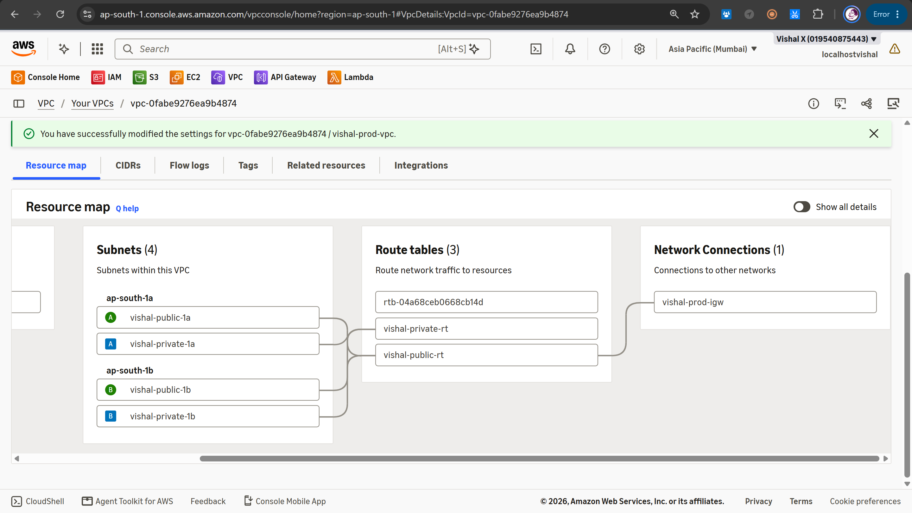
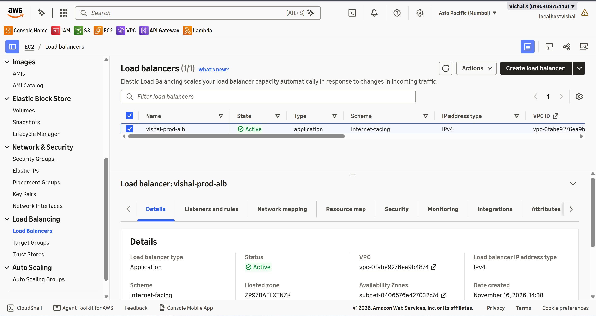
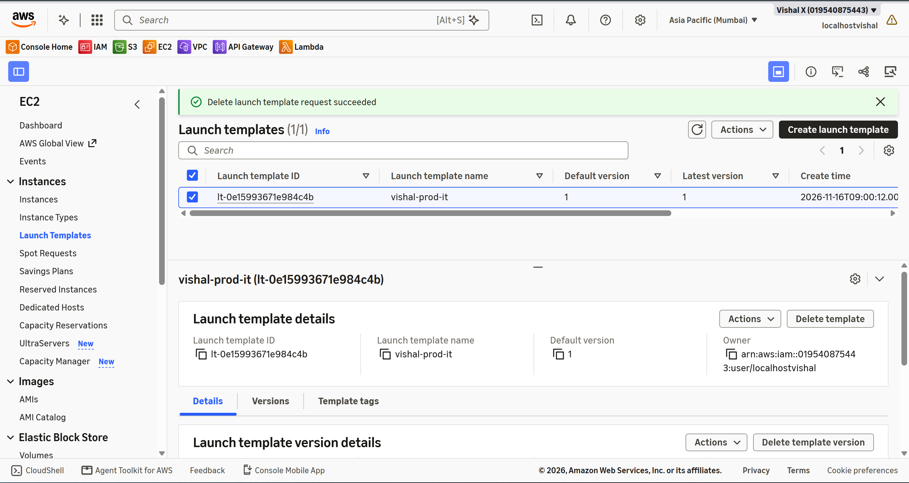
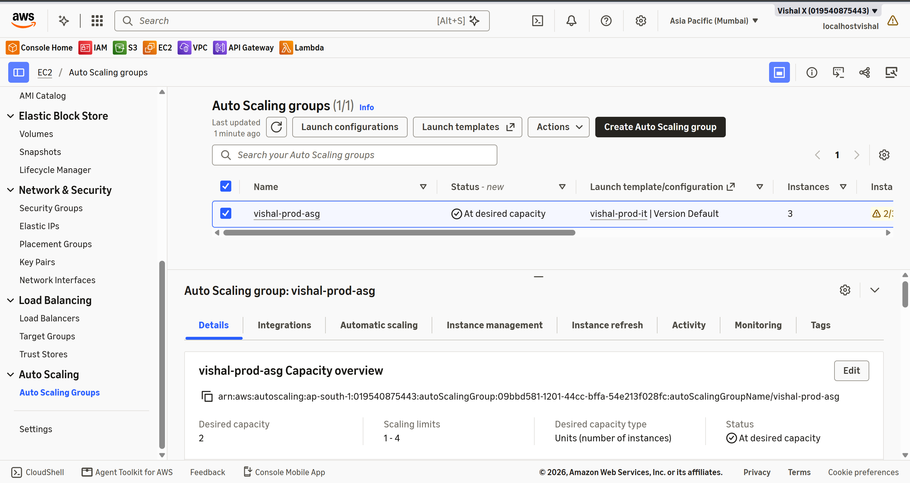
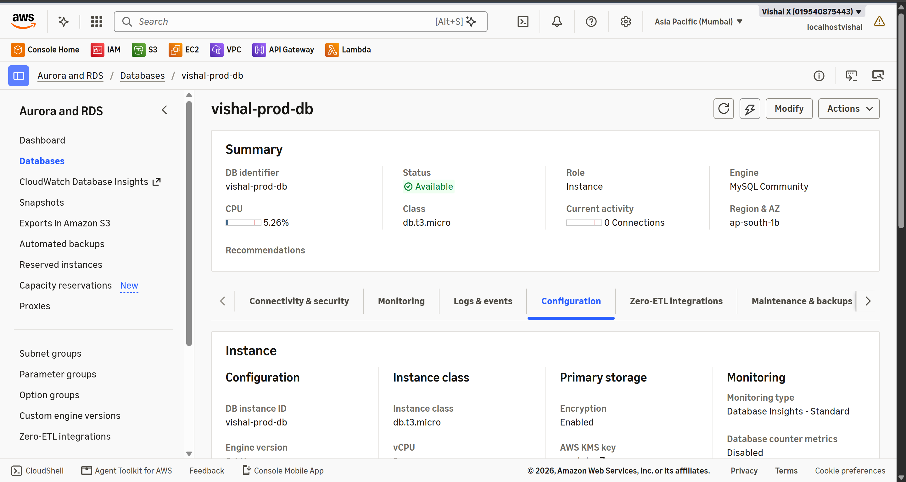
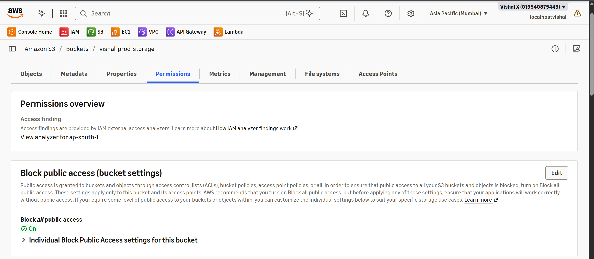
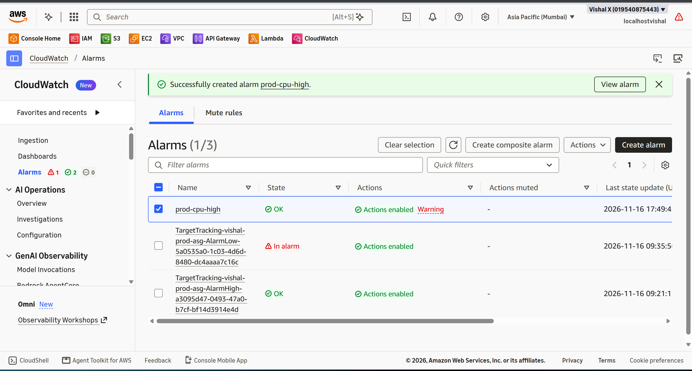
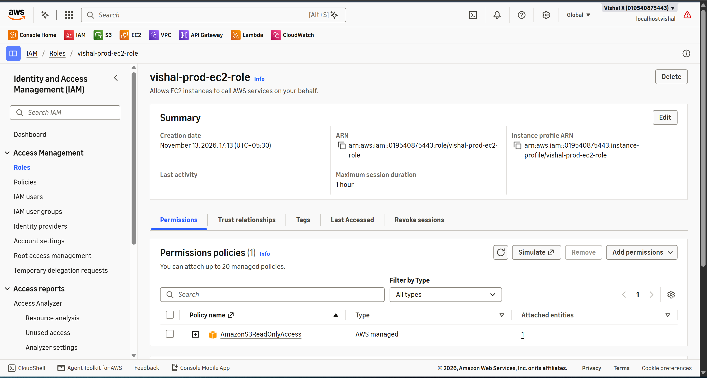

# Production-Style AWS Architecture

Twentieth project. The final one. Brought everything from the previous 19 projects together into one architecture — custom VPC, public and private subnets across two AZs, Application Load Balancer, EC2 in an Auto Scaling Group, RDS Multi-AZ, S3, CloudWatch, and IAM roles.

## What I built

A multi-tier architecture that mirrors how a real production environment is structured. The ALB sits in public subnets and handles all incoming traffic. EC2 runs in private subnets — never directly reachable from the internet. RDS is in private subnets with Multi-AZ for automatic failover. S3 handles storage. CloudWatch monitors everything. IAM roles mean no hardcoded credentials anywhere.


## Why this architecture

Every project in this series built one piece. This one is about putting all the pieces together and seeing how they connect. A load balancer without Auto Scaling doesn't self-heal. Auto Scaling without a private subnet isn't secure. RDS without Multi-AZ is a single point of failure. It only makes sense when everything is working together.

## Services used

| Service | What I used it for |
|---------|-------------------|
| VPC | Custom network with public and private subnets across two AZs |
| EC2 | Application servers running in private subnets |
| ALB | Internet-facing load balancer in public subnets |
| Auto Scaling Group | Automatically scales EC2 instances based on demand |
| RDS MySQL | Multi-AZ relational database in private subnets |
| S3 | Private storage for uploads and static files |
| CloudWatch | Monitoring, alarms, and metrics |
| IAM | Roles and policies for secure access |

## Resources I created

| Resource | Value |
|----------|-------|
| Region | ap-south-1 |
| VPC CIDR | 10.0.0.0/16 |
| Public Subnet AZ-A | 10.0.1.0/24 |
| Public Subnet AZ-B | 10.0.2.0/24 |
| Private Subnet AZ-A | 10.0.3.0/24 |
| Private Subnet AZ-B | 10.0.4.0/24 |
| ALB name | vishal-prod-alb |
| ASG name | vishal-prod-asg |
| RDS identifier | vishal-prod-db |
| S3 bucket | vishal-prod-storage |

---

## Steps

### 1. Created the custom VPC

1. Open the **VPC** console
2. Click **Your VPCs** → **Create VPC**
3. On the Create VPC page:
   - Name: `vishal-prod-vpc`
   - IPv4 CIDR: `10.0.0.0/16`
4. Click **Create VPC**

**Internet Gateway:**
1. VPC → **Internet Gateways** → **Create internet gateway**
   - Name: `vishal-prod-igw` → **Create**
2. Tick it → **Actions** → **Attach to VPC** → select `vishal-prod-vpc` → **Attach**

**Public Subnets** (create each separately):
1. VPC → **Subnets** → **Create subnet**
   - VPC: `vishal-prod-vpc`
   - Subnet name: `vishal-public-1a` — AZ: pick AZ-A — CIDR: `10.0.1.0/24`
2. Repeat for `vishal-public-1b` — AZ-B — `10.0.2.0/24`
3. For each public subnet: tick it → **Actions** → **Edit subnet settings** → tick **Enable auto-assign public IPv4** → **Save**

**Private Subnets:**
1. Create `vishal-private-1a` — AZ-A — `10.0.3.0/24`
2. Create `vishal-private-1b` — AZ-B — `10.0.4.0/24`

**Route Tables:**
1. VPC → **Route Tables** → **Create route table**
   - Name: `vishal-public-rt` — VPC: `vishal-prod-vpc` → **Create**
2. Click the route table → **Routes** tab → **Edit routes** → **Add route**
   - Destination: `0.0.0.0/0` — Target: select the Internet Gateway → **Save**
3. **Subnet associations** tab → **Edit subnet associations** → tick both public subnets → **Save**
4. Create a second route table `vishal-private-rt` — associate with both private subnets (no internet route)

**Enable DNS hostnames:**
VPC → tick `vishal-prod-vpc` → **Actions** → **Edit VPC settings** → tick **Enable DNS hostnames** → **Save**



---

### 2. Deployed the Application Load Balancer

1. Open the **EC2** console
2. In the left sidebar click **Load Balancing** → **Load Balancers** → **Create load balancer**
3. Click **Create** under **Application Load Balancer**
4. On the Create ALB page:
   - Name: `vishal-prod-alb`
   - Scheme: **Internet-facing**
   - IP address type: **IPv4**
   - VPC: `vishal-prod-vpc`
   - Availability Zones: tick both public subnets
   - Security group: create new — name `alb-sg` — inbound: HTTP 80 from `0.0.0.0/0`
5. Listeners and routing: create a new target group
   - Name: `vishal-prod-tg` — Target type: Instances — Protocol: HTTP — Port: 80 — Health check path: `/`
6. Click **Create load balancer**



---

### 3. Created the Launch Template

1. EC2 → **Launch Templates** → **Create launch template**
2. On the Create launch template page:
   - Name: `vishal-prod-lt`
   - AMI: **Amazon Linux 2**
   - Instance type: **t3.micro**
   - Key pair: select existing
   - Security group: create new — name `ec2-sg` — inbound: HTTP 80 from `alb-sg` only
   - IAM instance profile: attach the EC2 role created in step 8
   - User data:

```bash
#!/bin/bash
yum update -y
yum install -y httpd
systemctl start httpd
systemctl enable httpd
echo "<h1>Hello from $(hostname -f)</h1>" > /var/www/html/index.html
```

3. Click **Create launch template**



---

### 4. Configured the Auto Scaling Group

1. EC2 → **Auto Scaling Groups** → **Create Auto Scaling group**
2. On the wizard:
   - Name: `vishal-prod-asg`
   - Launch template: `vishal-prod-lt` → **Next**
   - VPC: `vishal-prod-vpc`
   - Subnets: select both **private** subnets → **Next**
   - Load balancing: tick **Attach to an existing load balancer** → select `vishal-prod-tg`
   - Health check type: **ELB** → **Next**
   - Desired capacity: `2` — Minimum: `1` — Maximum: `4`
   - Scaling policy: **Target tracking** → CPU utilization → target value: `60` → **Next**
3. Click **Create Auto Scaling group**



---

### 5. Set up RDS Multi-AZ

1. Open the **RDS** console
2. Click **Create database**
3. On the Create database page:
   - Engine: **MySQL**
   - Template: **Production** (enables Multi-AZ)
   - DB instance identifier: `vishal-prod-db`
   - Master username: `admin`
   - Master password: use a strong password — store it securely, not in documentation
   - DB instance class: `db.t3.micro`
   - Storage: 20 GiB gp2
   - Multi-AZ deployment: **Yes**
   - VPC: `vishal-prod-vpc`
   - Subnet group: create new using the private subnets
   - Security group: create new — name `rds-sg` — inbound: MySQL 3306 from `ec2-sg` only
   - Public access: **No**
4. Click **Create database**
5. Wait for status to show **Available**



---

### 6. Configured S3 storage

1. Open the **S3** console
2. Click **Create bucket**
3. On the Create bucket page:
   - Bucket name: `vishal-prod-storage-YOURACCOUNTID`
   - Region: same as the rest of the architecture
   - Block all public access: **enabled**
4. Click **Create bucket**
5. Click the bucket → **Properties** tab → **Bucket Versioning** → **Edit** → **Enable** → **Save**



---

### 7. Enabled CloudWatch monitoring

1. Open the **CloudWatch** console
2. In the left sidebar click **Alarms** → **All alarms** → **Create alarm**
3. Click **Select metric** → **EC2** → **By Auto Scaling Group** → search for `vishal-prod-asg` → tick **CPUUtilization** → **Select metric**
4. On the Specify metric and conditions page:
   - Statistic: **Average**
   - Period: **1 minute**
   - Threshold: **Greater than** `60`
   - Datapoints to alarm: `2` out of `2`
5. Click **Next** → configure SNS notification → **Next**
6. Alarm name: `prod-cpu-high` → **Create alarm**



---

### 8. Configured IAM security

1. Open the **IAM** console
2. Click **Roles** → **Create role**
3. On the Create role page:
   - Trusted entity: **AWS service** → **EC2**
   - Permissions: attach `AmazonS3ReadOnlyAccess`
   - Role name: `vishal-prod-ec2-role`
4. Click **Create role**
5. Go back to the Launch Template and attach this role as the IAM instance profile



---

### 9. Tested the architecture

1. Copy the ALB DNS name from EC2 → Load Balancers → click `vishal-prod-alb` → **DNS name**
2. Open it in a browser — the page loads showing the EC2 hostname
3. Refresh — the ALB routes to the other instance

**Simulate EC2 failure:**
1. EC2 → Instances → terminate one of the ASG instances
2. Watch the ASG automatically launch a replacement

**Verify RDS Multi-AZ failover:**
1. RDS → select the database → **Actions** → **Reboot** → tick **Reboot with failover** → **Confirm**
2. The primary switches to the standby — the endpoint DNS stays the same


---

### 10. Cleaned up

Delete in this order to avoid dependency errors:

1. ASG → set desired/min/max to `0` → delete the ASG
2. EC2 → terminate any remaining instances
3. RDS → delete the database (skip final snapshot)
4. ALB → delete load balancer → delete target group
5. S3 → empty bucket → delete bucket
6. VPC → delete subnets → delete route tables → detach and delete Internet Gateway → delete VPC
7. IAM → delete `vishal-prod-ec2-role`
8. CloudWatch → delete `prod-cpu-high` alarm
9. SNS → delete the topic

---

## Screenshots

| # | File | Description |
|---|------|-------------|
| 01 | `screenshots/01-vpc-created.png` | VPC with subnets and route tables created |
| 02 | `screenshots/02-alb-created.png` | ALB with state Active |
| 03 | `screenshots/03-launch-template.png` | Launch template created |
| 04 | `screenshots/04-asg-created.png` | Auto Scaling Group with desired=2 and instances launching |
| 05 | `screenshots/05-rds-created.png` | RDS database with status Available and Multi-AZ Yes |
| 06 | `screenshots/06-s3-bucket.png` | S3 bucket with versioning enabled |
| 07 | `screenshots/07-cloudwatch-alarms.png` | CloudWatch alarm configured for CPU |
| 08 | `screenshots/08-iam-role.png` | IAM role with attached policies |
| 09 | `screenshots/09-application-test.png` | Browser showing the application via ALB DNS |

## Commands

See [commands/commands.md](./commands/commands.md)

---

## Things that can go wrong

| Problem | What caused it | How I fixed it |
|---------|----------------|----------------|
| ALB returns 502 | EC2 instances not healthy | Checked target group health, verified web server was running |
| EC2 instances not launching | Launch template misconfigured | Checked user data script and security group |
| RDS connection refused | Security group blocking | Ensured EC2 security group was allowed in RDS security group inbound |
| ASG not scaling | Scaling policy not triggered | Checked CloudWatch metrics and alarm state |

---

## Security considerations

- EC2 instances are in private subnets — not directly accessible from the internet
- Only the ALB is in public subnets
- RDS is in private subnets — only accessible from EC2 via security group rules
- S3 bucket is private — no public access
- IAM roles follow least privilege — no hardcoded credentials anywhere
- All traffic to the application goes through the ALB

---

## Cost

This architecture uses multiple services — costs add up quickly. EC2 (x2), RDS Multi-AZ, and ALB are the main costs. Delete all resources after the exercise to avoid ongoing charges. Use the [AWS Pricing Calculator](https://calculator.aws) to estimate costs before running this long-term.

---

## What I learned

- A production architecture separates public-facing resources (ALB) from application servers (EC2 in private subnets)
- Multi-AZ means resources are spread across two Availability Zones for high availability
- Auto Scaling automatically replaces failed instances — the application self-heals
- RDS Multi-AZ provides automatic failover — the endpoint stays the same after failover
- Security groups form a chain: internet → ALB SG → EC2 SG → RDS SG
- IAM roles on EC2 instances eliminate the need for hardcoded credentials
